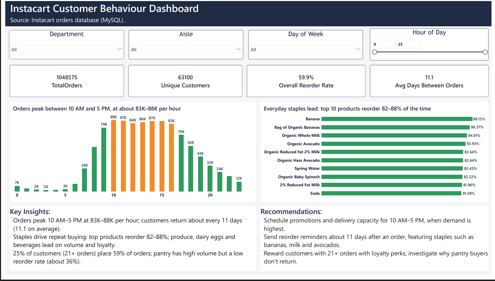
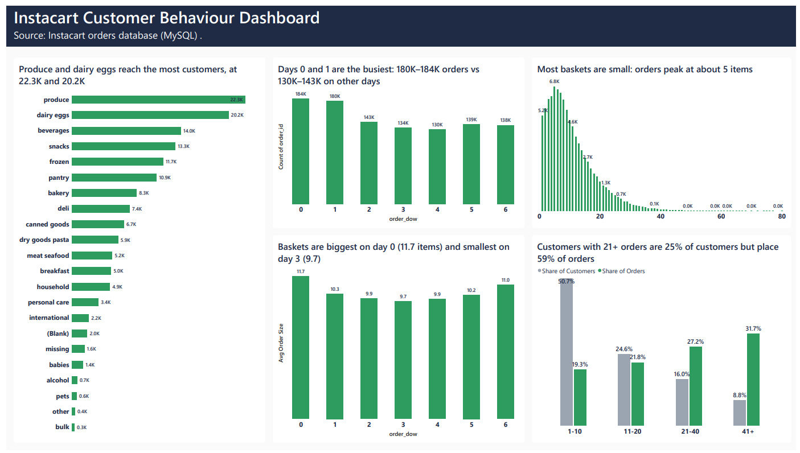
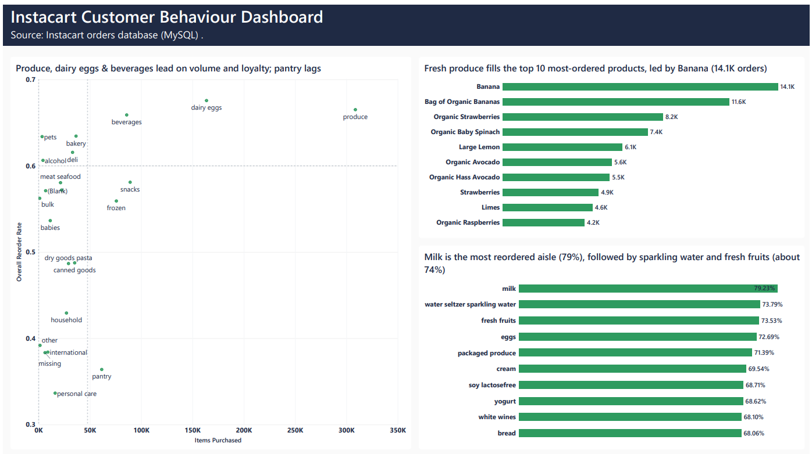
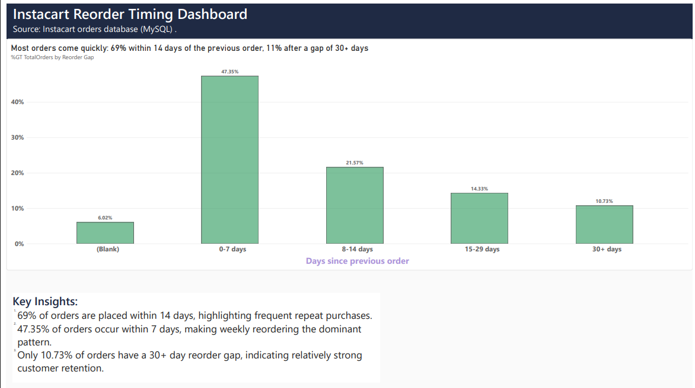

# Instacart Market Analysis: 1.05M orders in SQL, Excel and Power BI

An end-to-end analysis of 1,048,575 online grocery orders from 63,100 customers. I audited the data first, answered 20 business questions in MySQL, summarised the results in Excel, and built a 4-page Power BI dashboard. The goal is to help Marketing, Operations and Merchandising decide **when to promote, how to keep customers coming back, and which products to push**.

**Tools:** MySQL (joins, subqueries, derived tables, `GROUP_CONCAT`) · Excel (formulas, charts, PivotTable) · Power BI (DAX measures, calculated columns, relationships)

**Data:** the public Instacart Online Grocery Shopping dataset, loaded in a MySQL database with five tables: `aisles`, `departments`, `products`, `orders` and `order_products_train`.

## Business problem

| Team | Decision it needs |
|---|---|
| Marketing | When to run promotions and when to send reorder reminders |
| Operations | How much delivery capacity to plan by hour and day |
| Merchandising | Which products and aisles drive repeat buying |

## Key findings

1. **Ordering peaks in the middle of the day.** Hours 10:00 to 16:59 each carry 83K to 88K orders. The peak hour is 10:00 with 88,228 orders.
2. **Two days dominate.** Days 0 and 1 have 183,939 and 180,025 orders, against 130K to 143K on the other days. Instacart does not publish which number is which weekday, so I kept the numbers.
3. **A quarter of customers drive most orders.** Customers with 21 or more orders are about 25% of customers but place 59% of orders.
4. **Customers come back quickly.** Among repeat orders, 50% arrive within 7 days of the previous one and 73% within 14 days. 11% wait 30 days or more. Gaps are capped at 30 days in the data, so the average of 11.1 days is a minimum.
5. **Staples drive repeat buying.** Banana has the highest reorder rate (88.2%) of the products bought more than 1,000 times, and the milk aisle leads the aisles at 79.2%. Produce, dairy eggs and beverages lead on volume and loyalty, while pantry lags at about 36%.
6. **Baskets have natural partners.** Customers who buy Banana most often also buy Organic Avocado (12.0% of Banana orders, lift 2.13).

**Recommendations:** schedule promotions and delivery capacity for 10 AM to 5 PM and for days 0 and 1; send reorder reminders at about 7 to 14 days and a win-back offer near 30 days; reward customers with 21+ orders; keep staples always in stock; and bundle items that sell together.

## Data audit

I ran seven checks (`02_sql/market_analysis_data_audit.sql`) before analysing anything.

| Check | Result |
|---|---|
| Row counts | aisles 134, departments 21, products 49,355, orders 1,048,575, line items 1,048,575 |
| Duplicate keys | None in any table |
| First orders | 63,100, with an empty gap value (stored as text, not NULL) |
| Customers in the data | Customers 1 to 63,100, all with complete order histories |
| Line items with no matching order | 730,524 (69.7%), from 69,322 orders |
| Orders that have line items | 30,252 (2.9% of all orders), all from the train set |
| Line items with no matching product | 6,825 (0.7%) |
| Caps | Gap between orders capped at 30 days (112,498 orders); 100 orders per customer maximum (431 customers) |
| Placeholders | 1,254 products in a "missing" aisle and department; 1 corrupted product name |

**What this means:** the orders table holds the full history of 63,100 customers, but the line-item table comes from a separate, truncated extract that links to only 30,252 of those orders. Order-level and customer-level metrics use all 1,048,575 orders. Product metrics use all 1,048,575 line items. Metrics that combine the two (Q10 and Q18, and the Day and Hour filters on product views) cover those 30,252 orders only.

## Questions answered

All queries are in `02_sql/market_analysis_queries.sql`, and every result is in `04_excel/Market_analysis_results.xlsx` (one tab per question).

| # | Question | Answer |
|---|---|---|
| Q1 | Top 10 aisles by number of products | candy chocolate 1,235, then ice cream ice 1,084 and vitamins supplements 1,030 (the "missing" placeholder aisle excluded) |
| Q2 | Unique departments | 20 real departments (21 rows including "missing") |
| Q3 | Products across departments | personal care 6,524 (13.2%), snacks 6,221, pantry 5,331 |
| Q4 | Top 10 products by reorder rate | Banana 88.15%, Bag of Organic Bananas 86.37%, Organic Whole Milk 84.81% (products bought more than 1,000 times) |
| Q5 | Unique customers | 63,100 |
| Q6 | Average days between orders | 11.1 overall, first orders excluded, capped at 30 |
| Q7 | Peak order hours | 10:00 (88,228), 11:00, 14:00, 15:00, 13:00 |
| Q8 | Orders by day of week | day 0: 183,939; day 1: 180,025; day 4 quietest at 130,367 |
| Q9 | Top 10 most ordered products | Banana 14,136, Bag of Organic Bananas 11,639 |
| Q10 | Customers per department | produce 22,303, dairy eggs 20,153, beverages 14,024 (orders with line items only) |
| Q11 | Average products per order | 10.53 |
| Q12 | Most reordered products per department | produce: Banana (12,461 reorders); dairy eggs: Organic Whole Milk (3,154); pantry: Extra Virgin Olive Oil (780) |
| Q13 | Products reordered more than once | 20,085 |
| Q14 | Average cart size | 10.53, which matches Q11 |
| Q15 | Orders by hour | lowest at 03:00 (1,649), highest at 10:00 (88,228) |
| Q16 | Order size distribution | most common basket is 5 items (6,791 orders); the largest has 80 |
| Q17 | Reorder rate by aisle | milk 79.23%, water seltzer sparkling water 73.79%, fresh fruits 73.53% |
| Q18 | Average order size by day | day 0: 11.72 items, day 3: 9.67 (orders with line items only) |
| Q19 | Customers with the most orders | many customers tie at the 100-order cap |
| Q20 | Products per aisle and department | candy chocolate (snacks) 1,235 leads among real aisles |
| Bonus 1 | Loyalty groups | 21+ orders: 24.7% of customers, 58.9% of orders |
| Bonus 2 | Gap between orders | 0-7 days 50.4%, 8-14 days 22.9%, 15-29 days 15.2%, 30+ days 11.4% |
| Bonus 3 | Bought with Banana | Organic Avocado 1,693 orders together, lift 2.13 |

## Dashboard (Power BI)

The 4 pages are exported in `03_powerbi/Market_analysis_dashboard.pdf`. Screenshots are in `05_screenshots/`.

## Data notes and limitations

- **Reorder Timing page:** its percentages are shares of **all** orders, including the 63,100 first orders that have no previous order. That is why it shows 69% within 14 days. The SQL (Bonus 2) and Excel results exclude first orders and give 73%.
- **Placeholder categories:** "(Blank)" in some department charts is the 6,825 line items with no matching product, and "missing" is a placeholder department. Neither is a real department.
- **Day numbering:** `order_dow` is coded 0 to 6 and the weekday mapping is not published.
- **Gaps and caps:** the gap between orders stops at 30 days, and customers stop at 100 orders in this data.

## Repository contents

| Folder | Contents |
|---|---|
| `02_sql` | Data audit queries and the 20 analysis queries plus three extras |
| `03_powerbi` | Dashboard export (PDF) |
| `04_excel` | Results workbook with KPIs, data-quality tab, insights and one tab per question |
| `05_screenshots` | Dashboard pages and SQL result screenshots |